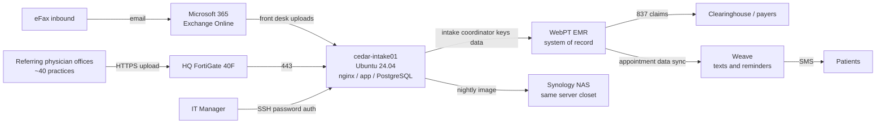

# Client Profile, Cedar Elm Rehab Partners, LLC

> I made up Cedar Elm Rehab Partners for this case study. Any resemblance to a real company is a coincidence, and all patient data in this project is fabricated. The technical testing described in this project was performed on a lab replica, not on a real organization's systems.

## 1. Organization at a glance

| Attribute | Detail |
|---|---|
| Legal name | Cedar Elm Rehab Partners, LLC (d/b/a Cedar Elm Physical Therapy) |
| Founded | 2011, by a physical therapist (current CEO) with a single clinic in Arlington, TX |
| Headquarters | Arlington, TX (administrative office co-located with the flagship clinic) |
| Locations | 7 outpatient clinics: Arlington (HQ), Grand Prairie, Mansfield, Irving, Euless, Keller, Frisco |
| Services | Outpatient orthopedic physical therapy, sports rehab, post-surgical rehab, occupational therapy (2 sites), work conditioning for workers' comp patients |
| Workforce | 142 total: 118 W-2 employees and 24 PRN/contract clinicians |
| Revenue | ~$21M (FY2025) |
| Patient volume | ~165,000 visits per year; ~61,000 unique patient charts in the EMR since 2014 |
| Payer mix | Commercial 46%, Medicare/Medicare Advantage 31%, Texas workers' comp 12%, personal injury/letters of protection 7%, self-pay 4% |
| Ownership | Founder-owned until a 2024 minority recapitalization by Larkspur Lane Capital (fictional), a Dallas-based healthcare growth fund |
| Regulatory status | HIPAA covered entity (bills insurers electronically); "covered entity" under the Texas Medical Records Privacy Act (Tex. Health & Safety Code Ch. 181) and Texas SB 1188 (Ch. 183) |

## 2. Why this assessment is happening now

Four things came together in Q3 2026, and each one is a common reason a small healthcare organization ends up commissioning a risk assessment.

1. Cyber insurance renewal (January 1, 2027). The carrier's renewal questionnaire asks for MFA on all email and remote access, EDR on all endpoints, and offline or immutable backups. Leadership could not answer "yes" to any of the three with confidence.
2. Stale HIPAA risk analysis. The last Security Rule risk analysis was a checklist completed by a previous MSP in 2022. HHS OCR's Risk Analysis Initiative has produced over a dozen enforcement actions for missing or inadequate risk analyses, and the investor's counsel flagged this during the 2024 recap.
3. Growth. Cedar Elm has signed a letter of intent to acquire two independent clinics (Weatherford and Denton) in Q1 2027. The investor wants a security baseline before adding more locations, users, and systems.
4. Texas SB 1188. Since January 1, 2026, electronic health records under a Texas covered entity's control must be physically maintained in the U.S. No one at Cedar Elm has confirmed where its vendors store data.

## 3. People and governance

| Role | Person (fictional) | Security / privacy responsibility |
|---|---|---|
| CEO / Founder | Dr. Renee Castillo, PT, DPT | Executive sponsor; risk acceptance authority |
| COO | Marcus Webb | Owns clinic operations, front-desk staffing |
| CFO | Priya Natarajan | Owns IT budget; IT Manager reports to her |
| Director of Revenue Cycle & HIPAA Privacy Officer | Dana Okafor | Privacy Officer (dual role); handles patient complaints, records requests, breach assessments |
| IT Manager & designated HIPAA Security Officer | Tom Brandt | Only in-house IT staff; administers M365, AD, network, and the intake server |
| Managed Service Provider | TriCounty Tech Partners (fictional) | Co-managed help desk, patching for Windows endpoints, firewall changes on request |

Governance observations from interviews
- No security committee; security topics reach leadership only when something breaks.
- Policies exist (a 2019 HIPAA policy binder purchased from a template vendor) but have not been reviewed since 2022.
- HIPAA training is annual, via a 30-minute video. Texas law (H&S Code §181.101) also requires training within 90 days of hire, retraining after material changes in law, and a signed completion statement kept for six years. Completion is tracked in a spreadsheet that is 7 months out of date, and signed statements are not collected for PRN staff.
- Front-desk turnover is high (~45% annually), which strains onboarding and offboarding.

## 4. IT environment

### 4.1 Systems inventory (in-scope)

| ID | System | Type | Hosting | ePHI? | Owner |
|---|---|---|---|---|---|
| SYS-01 | WebPT (EMR, scheduling, billing) | SaaS | Vendor-hosted | Yes, primary system of record | Revenue Cycle |
| SYS-02 | Microsoft 365 Business Premium (Exchange Online, SharePoint/OneDrive, Teams, Entra ID, Intune, Defender for Business) | SaaS | Microsoft cloud | Yes (email, scanned documents) | IT |
| SYS-03 | Weave (VoIP phones, patient texting, appointment reminders, review requests) | SaaS | Vendor-hosted | Yes (patient names, phone numbers, appointment details, free-text messages) | Operations |
| SYS-04 | cedar-intake01: Referral Intake Portal | Ubuntu 24.04 LTS VM; nginx + Gunicorn (Python) + PostgreSQL 16 | On-prem, Hyper-V host at HQ | Yes: referral orders, insurance card images, diagnosis codes | IT (inherited from contractor) |
| SYS-05 | Active Directory domain controller (CEDAR-DC01, Windows Server 2019), synced to Entra ID | VM | On-prem, Hyper-V host | Indirect (identity) | IT |
| SYS-06 | File server (CEDAR-FS01, Windows Server 2019) | VM | On-prem, Hyper-V host | Yes (legacy scanned records, 2011-2016) | IT |
| SYS-07 | Hyper-V host (Dell PowerEdge T350) and Synology NAS backup target | Physical | HQ server closet | Yes (backup images) | IT |
| SYS-08 | FortiGate 40F firewalls (one per clinic), site-to-site VPN to HQ | Network | Each clinic | Transit | MSP |
| SYS-09 | ~150 Windows 11 workstations and laptops; front-desk kiosk PCs; 9 laptops used by athletic trainers at partner high schools | Endpoint | Clinics / field | Yes (cached data, downloads) | IT / MSP |
| SYS-10 | Paylocity (HR and payroll) | SaaS | Vendor-hosted | No PHI; employee PII | CFO |

### 4.2 The Referral Intake Portal (cedar-intake01)

This system is the focus of the technical control audit.

- Purpose. About 40 referring orthopedic and primary-care offices upload referral packets (orders, clinical notes, insurance cards) through a web form. Fax referrals arrive via eFax-to-email and are uploaded by front-desk staff. Intake coordinators review each packet and key it into WebPT.
- History. Built in 2023 by a freelance developer because WebPT's referral intake didn't fit Cedar Elm's workflow. The contract ended in mid-2024; the developer's local account was never formally removed. The IT Manager in-place upgraded the VM from Ubuntu 22.04 to 24.04 in 2025.
- Exposure. HTTPS (443) is published to the internet through the HQ FortiGate so outside offices can upload. SSH (22) is reachable from the internal network and site-to-site VPN; the IT Manager logs in with a password.
- Data. About 18,400 referral packets (January 2024 to present). No retention schedule is enforced; nothing has ever been purged.
- Not covered by the MSP's patching. The MSP agreement covers Windows only. Ubuntu updates are applied "when Tom gets to it."
- Backup. A Veeam job images the VM nightly to the Synology NAS in the same closet. Restores have never been tested.

### 4.3 Data flow

## 5. Third parties handling ePHI

| Vendor | Service | BAA on file? | Last security review |
|---|---|---|---|
| WebPT | EMR, billing, scheduling | Yes (signed 2014, no newer version on file) | Never |
| Microsoft | M365 | Included in Microsoft Product Terms / DPA | Never |
| Weave | Phones, texting, reminders | Clicked through at onboarding in 2021; no copy saved | Never |
| TriCounty Tech Partners | MSP | Yes (2022) | Never |
| eFax | Inbound fax | Unknown | Never |
| Shred vendor | Paper destruction | Yes | N/A |

The third-party assessment in this project covers the first three because they hold the most ePHI.

## 6. Applicable requirements

| Requirement | Why it applies | Key obligations relevant to this assessment |
|---|---|---|
| HIPAA Security Rule (45 CFR Part 164, Subpart C) | Covered entity | Risk analysis and risk management (§164.308(a)(1)), access control, audit controls, integrity, transmission security, contingency planning, BAAs |
| HIPAA Breach Notification Rule (§§164.400-414) | Covered entity | Notify individuals without unreasonable delay and within 60 days of discovery; HHS and media thresholds |
| Texas Medical Records Privacy Act (H&S Code Ch. 181, as amended by HB 300) | Texas covered entity | Workforce training within 90 days of hire with signed acknowledgment; stricter limits on electronic disclosure; state penalties |
| Texas SB 1188 (H&S Code Ch. 183) | Texas covered entity maintaining EHRs | U.S.-only physical storage of EHRs (effective Jan 1, 2026); access limited to treatment, payment, and operations roles |
| Texas Bus. & Com. Code §521.053 | Holds sensitive personal information of Texans | Notify the Texas AG within 30 days if a breach affects 250+ Texans |
| Proposed HIPAA Security Rule update (NPRM, Jan 2025) | Not yet final; HHS's target for a final rule is July 2027 | Treated as a forward-looking benchmark only (MFA, encryption, asset inventory, annual testing) |

## 7. Frameworks used

- NIST Cybersecurity Framework (CSF) 2.0 for the organizational current-state and target profile.
- NIST SP 800-53 Rev. 5 for control mapping of technical findings. (The OpenSCAP content references Rev. 4 control IDs, and the analysis notes where Rev. 5 differs.)
- CIS Ubuntu Linux 24.04 LTS Benchmark, Level 1 - Server for the technical baseline of cedar-intake01, via the open-source ComplianceAsCode content.
- NIST SP 800-66 Rev. 2 as the bridge between HIPAA Security Rule standards and NIST controls.
- HHS 405(d) Health Industry Cybersecurity Practices (HICP), small/medium practice guidance, to keep recommendations proportionate to a 142-person organization.
