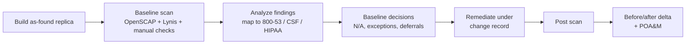

# Technical Control Audit of cedar-intake01

This is a configuration audit of the Referral Intake Portal server against the CIS Ubuntu Linux 24.04 LTS Benchmark, Level 1 - Server, done with free and open-source tools. I mapped each finding to NIST SP 800-53, NIST CSF 2.0 and, where the content provides it, the HIPAA Security Rule. I then fixed the findings under a change record and re-scanned the server to check the fixes. Every number in the report comes from the scan evidence in `results/`.

## Results (lab run, October 26, 2026)

| Metric | Baseline | Post-remediation |
|---|---|---|
| Tailored CIS L1 pass rate | 66.4% | 93.4% |
| Failed rules (excl. N/A by design) | 112 | 23 |
| Open failures (no approved exception) | 108 | 19 |
| High-severity failures | 4 | 2 (risk-accepted) |
| Lynis hardening index | 63 | 74 |

105 rules were remediated under change record `CR-20261026-193009`. The verification scan caught two regressions caused by my own remediation. Postfix was pulled in as an AIDE dependency, and `/etc/cron.allow` was created with the wrong group owner. It also found 12 password-quality rules that were skipped because their package was installed in the same run. All are tracked in the POA&M (POAM-24 to POAM-26) and in `remediation/post-remediation-dispositions.csv`. Evidence is in `results/`, with SHA-256 hashes in `results/SHA256SUMS`.

## Method



| Step | Script | Evidence produced |
|---|---|---|
| Build | `scripts/00_build_target.sh` | `/var/log/cedar-build.log` |
| Toolchain | `scripts/01_install_tools.sh` | `toolchain.txt` (versions, content SHA-256) |
| Baseline scan | `scripts/02_scan.sh baseline` | XCCDF results, HTML report, Lynis report, manual checks, `findings.csv`, `summary.json` |
| Remediate | `scripts/03_remediate.sh` | `remediation/change-record-*.md`, tailoring file, remediation results |
| Post scan | `scripts/02_scan.sh post` | Same as baseline |
| Compare | `scripts/04_compare.py` | `delta.csv`, `delta.md` |

## Tools (all free)

| Tool | Purpose |
|---|---|
| [OpenSCAP](https://www.open-scap.org/) `oscap` | SCAP scanner that evaluates the CIS profile and performs automated remediation |
| [ComplianceAsCode](https://github.com/ComplianceAsCode/content) v0.1.82 | CIS Ubuntu 24.04 profiles, with control references to NIST 800-53, CSF, and HIPAA |
| [Lynis](https://cisofy.com/lynis/) | Independent second opinion (hardening index, warnings) |
| Python 3 + lxml | Result parsing, control mapping, before/after comparison |
| VirtualBox or VMware Workstation | Lab hypervisor with snapshots for rollback |

## Seeded "as-found" conditions

The build script reproduces the client's described environment. I deliberately seeded five conditions and labeled them so they can be traced into the report. All other findings come from a stock Ubuntu 24.04 install with the application stack.

| ID | Condition | Narrative source |
|---|---|---|
| AF-1 | Former contractor account `jmorales` still active and in `sudo` | Contract ended 2024; offboarding never done |
| AF-2 | SSH password authentication explicitly enabled | Contractor enabled it for outside troubleshooting |
| AF-3 | ePHI upload folder world-writable (0777), files 0666 | Contractor's quick fix for an upload error |
| AF-4 | PostgreSQL listening on all interfaces, VPN range allowed | Contractor connected remotely for debugging |
| AF-5 | Automatic security updates disabled | "An update broke the app once" |

All patient data is fabricated and labeled `SYNTHETIC TEST DATA` in the files themselves.

## Baseline decisions (tailoring)

A CIS benchmark is a starting point, and applying every rule without thought can break a service. `remediation/baseline-decisions.csv` records my decision for each rule I didn't simply remediate.

| Decision | Count | Example |
|---|---|---|
| N/A by design | 27 | nftables and iptables rules, since UFW is the chosen firewall |
| Business exception | 2 | nginx is required (CIS 2.1.18 says remove web servers unless needed) |
| Risk accepted | 2 | GRUB bootloader password (compensating control: restricted hypervisor console) |
| Deferred to POA&M | 17 | Separate partitions for /tmp, /var, etc. require a rebuild |
| Manual remediation | 9 | SSH `AllowUsers` and UFW rules need environment-specific values |

Two pass rates are reported: raw (every scored rule) and tailored (excluding N/A-by-design rules). Deferred items still count as failures until fixed.

---

## Run it yourself (about 1 hour, mostly waiting)

### 1. Create the VM (15 min)
1. Download the Ubuntu Server 24.04 LTS ISO from ubuntu.com (free).
2. In VirtualBox (free): 2 vCPU, 4 GB RAM, 25 GB disk, NAT network. Accept the installer's default disk layout (no custom partitions, which is part of the as-found state).
3. During install, create your admin user and tick Install OpenSSH server.
4. Optional, for key-based SSH later: add a NAT port-forward (host 2222 → guest 22) and run `ssh-copy-id -p 2222 <you>@127.0.0.1` from your host.

### 2. Copy the project to the VM
Clone or copy this folder to the VM (for example `scp -P 2222 -r cedar-elm-grc-assessment <you>@127.0.0.1:~`).

### 3. Build, scan, remediate, re-scan
```bash
cd ~/cedar-elm-grc-assessment/02-technical-audit/scripts
sudo bash 00_build_target.sh          # then take VM snapshot "as-found"
sudo bash 01_install_tools.sh
sudo bash 02_scan.sh baseline
#   -> take VM snapshot "pre-remediation"
sudo bash 03_remediate.sh             # optional: sudo ADMIN_CIDR=10.0.2.0/24 bash 03_remediate.sh
sudo reboot
sudo bash 02_scan.sh post
python3 04_compare.py ../results/baseline-* ../results/post-*
```

### 4. Keep your evidence
The scripts save everything you need in `results/` and `remediation/`. Keep these three items together, since they back up every number you report.
- `results/evidence-baseline-*.tar.gz`
- `results/evidence-post-*.tar.gz`
- `remediation/change-record-*.md`

### Troubleshooting
| Symptom | Fix |
|---|---|
| `01_install_tools.sh` cannot download the release zip | It falls back to building the content from source automatically (needs ~10 min) |
| Locked out of SSH after remediation | Use the VirtualBox console, or revert to the `pre-remediation` snapshot |
| Portal health check not HTTP 200 | `sudo systemctl status intake-portal nginx` and `sudo journalctl -u intake-portal -n 50` |
| oscap exits with code 2 | Expected. It means at least one rule failed |
