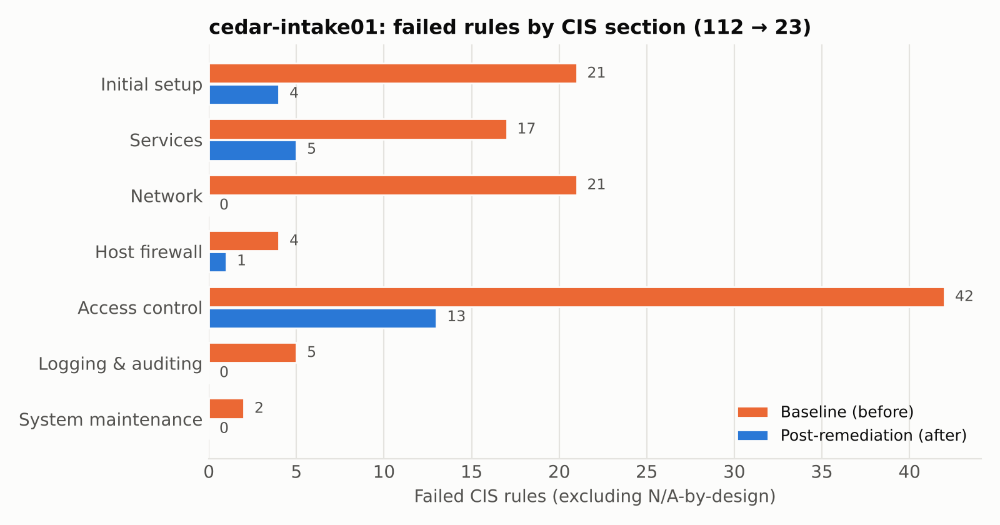

# Security Risk Assessment and Technical Control Audit

Client: Cedar Elm Rehab Partners, LLC (fictional) | Assessment period: October 2026 | Prepared by: Abhinav Koka

> This report presents a fictional healthcare organization assessed using simulated organizational evidence and technical testing in a controlled lab environment. All patient data is fabricated.

---

## 1. Executive summary

Cedar Elm Rehab Partners is a seven-clinic outpatient physical therapy group in Dallas-Fort Worth with 142 workforce members and about 61,000 patient charts. Leadership asked for this assessment ahead of a January 2027 cyber insurance renewal, two planned clinic acquisitions and new Texas rules on where health records can be stored. Their last HIPAA risk analysis was a 2022 checklist.

Overall, the security program is at an early stage. Average NIST CSF 2.0 maturity is 0.73 out of 4. A few protections are in place, such as MSP-managed Windows patching, Defender on most endpoints and an EMR from a major vendor. Governance, detection, response and recovery are mostly undocumented and untested.

| Area | Result |
|---|---|
| Organizational risk | 16 risks identified (4 Critical, 7 High, 5 Moderate). If the remediation plan is completed, none stay above Moderate. |
| Referral intake server | A hardening pass raised the CIS Level 1 pass rate from 66% to 93%. Four of the five initially identified server conditions have been remediated and verified. SSH password authentication remains enabled pending administrator key enrollment. |
| Third-party risk | Microsoft 365 scored 90 out of 100, Weave 50 and WebPT 28 (not enough public evidence to score it higher). None of the three has confirmed U.S. data storage, which Texas SB 1188 requires. |
| Remediation plan | 26 items with owners and dates. Four are complete and verified. |

Top five priorities for the next 90 days:

1. Turn on MFA for Microsoft 365 with Conditional Access and block legacy authentication. This is a relatively low-cost control with significant risk-reduction benefits, and the insurer requires it.
2. Make backups survivable: separate credentials, an immutable off-site copy and a tested restore.
3. Finish the intake server. That means enrolling an admin SSH key, turning off password login, running a second hardening pass and adding Linux to the MSP patch scope.
4. Fix offboarding with same-day account removal and quarterly access reviews. The contractor account I found on the intake server shows the risk is real.
5. Close the vendor gaps with current BAAs, confirmation that data stays in the U.S., and breach-notice terms.

---

## 2. Scope and approach

| In scope | Out of scope |
|---|---|
| Organizational security program (all 7 clinics and HQ) | Physical security walkthroughs |
| The Referral Intake Portal server (technical testing) | Penetration testing and exploitation |
| WebPT, Microsoft 365 and Weave (vendor review) | Medical devices and other vendors (eFax, MSP) |
| HIPAA Security Rule, Texas H&S Code Ch. 181 and 183, Tex. Bus. & Com. Code 521.053 | HIPAA Privacy Rule compliance audit |

| Workstream | Framework | Method |
|---|---|---|
| Organizational assessment | NIST CSF 2.0 and HHS 405(d) HICP | Interviews, document review, 0-4 maturity scoring |
| Risk analysis | Likelihood x impact (NIST SP 800-30 style) and HIPAA 164.308(a)(1) | 5x5 scoring, inherent and residual |
| Technical control audit | CIS Ubuntu 24.04 Level 1 Server, mapped to NIST SP 800-53 | OpenSCAP, Lynis and manual checks, then remediation under a change record and a re-scan |
| Third-party risk | Tiering plus an 8-domain scorecard | Review of public evidence |

Tool versions, evidence locations and the finding-by-finding references are in the technical appendix (`technical-appendix.md`).

---

## 3. Organizational assessment (NIST CSF 2.0)

| Function | Current | Target (12 mo) | Main gaps |
|---|---|---|---|
| Govern | 0.83 | 2.83 | No risk register or risk appetite, 2019 policies, no vendor oversight and no reporting to leadership |
| Identify | 0.67 | 2.67 | No asset inventory, risk analysis from 2022 and a Linux server that was never scanned |
| Protect | 1.20 | 3.00 | Partial MFA, shared logins, flat networks and unverified laptop encryption |
| Detect | 0.50 | 2.50 | Defender alerts go to one inbox and nobody aggregates or reviews logs |
| Respond | 0.50 | 2.50 | No incident response plan and no idea of the Texas AG 30-day notice rule |
| Recover | 0.00 | 2.50 | Restores have never been tested and there is no recovery plan |

The targets account for the organization's limited internal IT resources and reliance on its managed service provider. The recommendations follow the HHS 405(d) HICP practices for small and medium organizations.

---

## 4. Technical audit of the referral intake server

### 4.1 The system

The intake server is an Ubuntu 24.04 VM running nginx (a TLS reverse proxy), a Python (Gunicorn/Flask) application and PostgreSQL 16. It receives referral packets from about 40 outside practices over the internet. The production system is estimated to hold approximately 18,400 referral packets containing ePHI. The lab replica used for this assessment contained 60 fabricated packets. A contractor built it in 2023 and it sits outside the MSP's patch scope.

### 4.2 What the baseline scan showed

I scanned the server on October 26, 2026. Of the 408 rules in the CIS Level 1 Server profile, 112 applicable rules failed, a tailored pass rate of 66.4%. The failures were concentrated in access control and configuration management. The four high-severity failures were two bootloader-password rules and two rules that allow empty passwords. The Lynis hardening index was 63.

### 4.3 Findings

| ID | Finding | Rating | 800-53 | HIPAA | Status |
|---|---|---|---|---|---|
| TF-01 | Former contractor account `jmorales` still active, with a login shell and sudo | High | AC-2, PS-4 | 164.308(a)(3)(ii)(C) | Closed |
| TF-02 | SSH permitted password authentication and root login, with insufficient authentication restrictions. Empty passwords were also permitted by the SSH and local account configurations. No login banner was configured | High | IA-2, IA-5, AC-17, AC-8 | 164.312(d) | Partly closed |
| TF-03 | ePHI upload folder and all 60 referral files were world-writable | High | AC-3, AC-6 | 164.312(a)(1), (c)(1) | Closed |
| TF-04 | Host firewall inactive, so the web server, SSH and PostgreSQL were reachable on every interface | High | SC-7 | 164.312(e)(1) | Closed |
| TF-05 | PostgreSQL listening on all interfaces, with 10.0.0.0/8 permitted | Moderate | SC-7, CM-7 | 164.312(e)(1) | Closed |
| TF-06 | No audit logging of access to ePHI | High | AU-2, AU-12 | 164.312(b) | Closed |
| TF-07 | Automatic updates disabled, 27 updates pending | Moderate | SI-2 | 164.308(a)(1)(ii)(B) | Closed |
| TF-08 | 21 network kernel parameters left at insecure defaults | Moderate | SC-7 | 164.312(e)(1) | Closed |
| TF-09 | No file-integrity monitoring | Moderate | SI-7 | 164.312(c)(1) | Installed, one follow-up open |

TF-06 is a gap a scan alone would have missed, because CIS Level 1 does not require audit logging. I included it because HIPAA requires audit controls on systems that hold ePHI.

TF-02 is the one serious item still open. Password login stays on until an administrator SSH key is enrolled. Root login is off, access is limited to one named account, and the login banner and attempt limit are fixed.

### 4.4 Remediation and results

Before remediation, I reviewed and documented 57 CIS rules requiring an exception, deferral or environment-specific decision. Most were alternatives the server doesn't use (UFW is the firewall, so the nftables rules don't apply) or items deferred because they need a rebuild, such as separate partitions. Two were business exceptions because nginx is required, and two were accepted risks: the bootloader password, with a restricted hypervisor console as the compensating control.

I then ran remediation under a change record, with a VM snapshot as the rollback plan, rebooted the server and scanned it again.

| Measure | Before | After |
|---|---|---|
| Tailored CIS pass rate | 66.4% | 93.4% |
| Failed rules | 112 | 23 |
| High-severity failures | 4 | 2 (both accepted risks) |
| Failed rules citing HIPAA | 12 | 2 (both accepted risks) |
| Lynis hardening index | 63 | 74 |
| World-writable ePHI files | 60 | 0 |

### 4.5 What the re-scan caught

The re-scan was worth doing. It identified three issues introduced during remediation.

- Installing the file-integrity tool pulled in a mail client and, through it, a mail server. Postfix began listening on port 25 on every interface. The firewall's default deny blocks it, but it shouldn't be on this server at all.
- A cron access file was created with the wrong group owner after its rule had already been checked.
- The password-quality module arrived mid-run, so its 12 settings were skipped as not applicable.

All three are in the plan for a second hardening pass, along with a few low-risk leftovers: the nginx default site on port 80, AppArmor profile modes and a root PATH entry.

---

## 5. Third-party risk

| Vendor | Tier | Score | Rating |
|---|---|---|---|
| Microsoft 365 | 1 | 90 | Satisfactory |
| Weave | 2 | 50 | Follow-up required |
| WebPT | 1 | 28 | Insufficient public evidence |

None of these vendors is known to be weak, and a low score here means little public evidence, not that the vendor is insecure. The gap is on Cedar Elm's side. It has never asked these vendors for evidence, it still relies on a 2014 BAA for its system of record, and it can't show that its EHR data stays in the U.S. The request lists are in the workbook, and the full write-up is in `04-vendor-risk/vendor-risk-summary.md`.

---

## 6. Risk register summary

| ID | Risk | Inherent | Residual |
|---|---|---|---|
| R-01 | Ransomware reaches servers and backups | 20 Critical | 8 Moderate |
| R-02 | M365 account takeover or BEC | 16 Critical | 6 Moderate |
| R-03 | Intake portal compromise | 15 Critical | 8 Moderate |
| R-05 | Backups cannot be restored | 15 Critical | 6 Moderate |
| R-04 | Former users keep access | 12 High | 6 Moderate |
| R-06 | Vendor security failure | 12 High | 8 Moderate |
| R-08 | Lost laptop with unencrypted ePHI | 12 High | 2 Low |
| R-09 | Stale risk analysis leads to enforcement | 12 High | 3 Low |
| R-10 | Attacks go undetected | 12 High | 6 Moderate |
| R-11 | Incident or notification mishandled | 12 High | 6 Moderate |
| R-13 | Flat networks allow lateral movement | 12 High | 6 Moderate |
| R-07, R-12, R-14 to R-16 | SB 1188, workforce error, acquisitions, key person, training | 8-9 Moderate | 2-6 |

R-03 is the only risk where I could already carry out part of the technical treatment. Its controls went from "TLS only" to a hardened host with a default-deny firewall and ePHI audit logging. The risk register workbook has the scoring scales, heat maps and the link from each risk to its remediation items.

---

## 7. Remediation roadmap

| Horizon | Actions |
|---|---|
| Done | Intake server patched and hardened: contractor account disabled, ePHI permissions fixed, database restricted and CIS Level 1 hardening applied and verified |
| 0-30 days | SSH key-only login, second hardening pass, MFA through Conditional Access, send vendor request lists and record where M365 data lives |
| 30-90 days | Off-site immutable backup and first restore test, BitLocker enforcement, offboarding workflow, adopt the risk register and a data retention policy |
| 90-180 days | Incident response plan and tabletop exercise, DLP and message encryption, training platform, runbooks and break-glass accounts, acquisition due diligence |
| 180-365 days | Central logging and alerting, network segmentation and a rebuild of the intake server on a partitioned template |

The 26 items behind these actions, with owners, dates and control mappings, are in the POA&M workbook.

---

## 8. Regulatory notes

- HIPAA Security Rule update. HHS proposed a major overhaul in January 2025, including mandatory MFA, encryption, asset inventories and annual testing. As of October 2026 it is still only a proposed rule, and HHS has moved it to its long-term agenda with a July 2027 target. It isn't binding yet, but it targets the same gaps as R-02 (MFA) and R-08 (laptop encryption).
- Texas SB 1188 (H&S Code Ch. 183). Since January 1, 2026, electronic health records under a Texas covered entity's control must be physically kept in the U.S. Civil penalties run from $5,000 to $250,000 per violation depending on intent. This is why R-07 matters: none of the three vendors has confirmed where it stores data.
- Texas breach notice (Bus. & Com. Code 521.053). The Texas Attorney General must be told within 30 days once a breach is found to affect 250 or more Texans. That is shorter than HIPAA's 60-day outer limit, and Cedar Elm has no incident response plan and isn't aware of the rule (R-11).
- Texas training (H&S Code 181.101). Training is due within 90 days of hire, and signed completion statements must be kept for six years (R-16).
- Enforcement trend. OCR's Risk Analysis Initiative has produced more than a dozen enforcement actions since it began in late 2024, which is why a stale risk analysis is a real exposure for Cedar Elm (R-09).

---

## References

- NIST Cybersecurity Framework 2.0 (2024)
- NIST SP 800-53 Rev. 5 and NIST SP 800-66 Rev. 2 (HIPAA Security Rule implementation guide)
- CIS Ubuntu Linux 24.04 LTS Benchmark, via ComplianceAsCode
- HHS 405(d) Health Industry Cybersecurity Practices (HICP)
- 45 CFR Part 164 Subparts C and D, Texas Health & Safety Code Ch. 181 and 183, Texas Business & Commerce Code 521.053
- IBM Cost of a Data Breach Report 2025 (healthcare figures as reported by HIPAA Journal)
