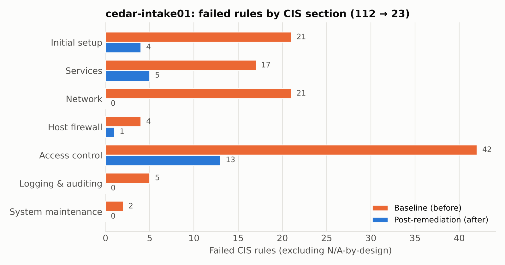

# HIPAA Security Risk Assessment and CIS Control Audit

A governance, risk and compliance case study for Cedar Elm Rehab Partners, a fictional seven-clinic physical therapy group in Dallas-Fort Worth. I did three things for it. I assessed the organization's risk against NIST CSF 2.0, the HIPAA Security Rule and Texas law. I audited an internet-facing server that holds ePHI against the CIS Benchmark and mapped the findings to NIST SP 800-53. And I reviewed the security evidence from three real healthcare software vendors.

> The client is fictional. The technical audit is real, but it was performed on a replica of the intake server that I built in a lab, not on a real organization's production system. All the figures come from that evidence. All patient data is fabricated.

## Results

| Workstream | Outcome |
|---|---|
| Technical audit | The CIS L1 tailored pass rate went from 66.4% to 93.4%, failed rules dropped from 112 to 23 (105 remediated) and the Lynis hardening index went from 63 to 74. Findings are mapped to NIST SP 800-53, CSF 2.0 and HIPAA. The re-scan caught 2 regressions that my own remediation introduced. |
| Risk assessment | 16 risks scored. The 4 Critical and 7 High risks drop to 0 Critical and 0 High residual if the plan is carried out, and CSF 2.0 maturity moves from 0.73 to a target of 2.73. |
| Vendor risk | 3 ePHI vendors tiered and scored on 8 domains using public evidence. None of the three could confirm U.S. data storage, which Texas SB 1188 requires. |
| Remediation | 26-item POA&M with owners, dates and control and regulation mapping. 4 items are verified closed with scan evidence. |



## What is in here

| Work | Where to find it |
|---|---|
| Risk register (likelihood x impact, inherent vs. residual) | `03-risk-assessment/cedar-elm-risk-register.xlsx` |
| Framework mapping across CSF 2.0, NIST SP 800-53, HIPAA and CIS | `02-technical-audit/scripts/parse_results.py` and the risk register |
| Control testing and audit evidence | `02-technical-audit/results/` |
| Baseline tailoring, exceptions and risk acceptance | `02-technical-audit/remediation/baseline-decisions.csv` |
| Remediation tracking (POA&M) and change management | `03-risk-assessment/cedar-elm-poam.xlsx` and the change record |
| Third-party risk review | `04-vendor-risk/` |
| Privacy and state law (Texas SB 1188, H&S 181, Bus. & Com. 521.053) | Company profile and report section 8 |
| Executive report and technical appendix | `05-report/` |

## Repository structure

```
01-company-profile/      Client profile, systems inventory, data flow and applicable law
02-technical-audit/      Scripts (build, scan, remediate, compare), baseline decisions and evidence
03-risk-assessment/      Risk register, heat maps, CSF 2.0 profile and POA&M
04-vendor-risk/          Vendor tiering, scorecard, evidence log and request lists
05-report/               Final assessment report (Markdown and PDF), technical appendix and figures
```

## Reproducing the technical audit

You need a free hypervisor (VirtualBox) and the Ubuntu Server 24.04 ISO. It takes about an hour, mostly waiting. The full steps are in [`02-technical-audit/README.md`](02-technical-audit/README.md).

```bash
sudo bash 00_build_target.sh     # as-found replica
sudo bash 01_install_tools.sh    # OpenSCAP, Lynis, ComplianceAsCode
sudo bash 02_scan.sh baseline
sudo bash 03_remediate.sh        # after snapshot
sudo bash 02_scan.sh post
python3 04_compare.py ../results/baseline-* ../results/post-*
```

## Tools

OpenSCAP, ComplianceAsCode (CIS Ubuntu 24.04), Lynis, Python (lxml, openpyxl), Excel, Mermaid and VirtualBox. All of them are free.
